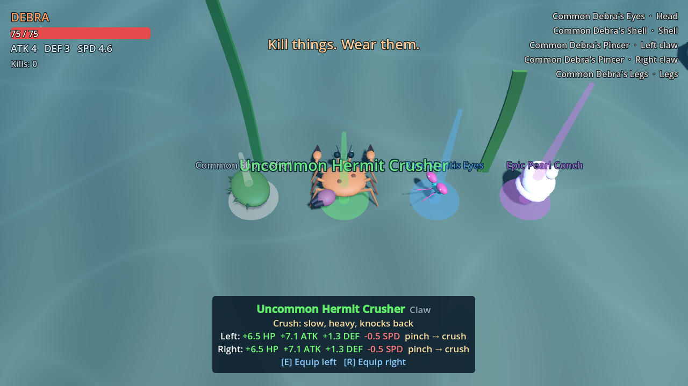
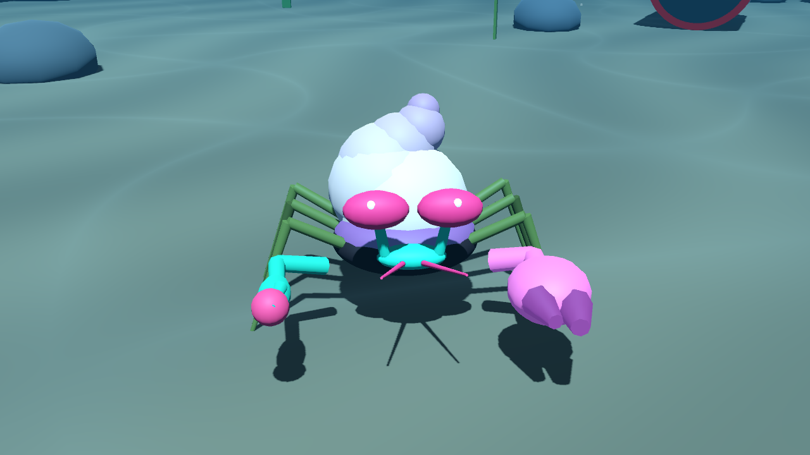

# Debra

A 3D action RPG where you play a little crustacean on the seafloor. Every kill drops a body part, and wearing it changes your stats, your attacks and your look. **You are what you kill.**

Built with **Godot 4.7.2**. It runs as a **Windows exe** and as a **mobile web app**.




## Play
- **Web / phone:** open this repo's GitHub Pages URL. On a phone, "Add to Home Screen" gives you fullscreen landscape.
- **Windows:** download `Debra.exe` from the latest Release or Actions run.

| | Keyboard & mouse | Gamepad | Touch |
|---|---|---|---|
| Move | WASD / arrows | Left stick | Left thumb |
| Aim | Mouse | Right stick | Auto-aim |
| Left claw attack | LMB / J | X / LB / LT | L CLAW |
| Right claw attack | RMB / K | B / RB / RT | R CLAW |
| Equip part (left claw) | E / F | A | EQUIP / EQUIP L |
| Equip to right claw | R | Y | EQUIP R |
| Dev: random part / spawn enemy / heal | F1 / F2 / F3 | | |

## Develop
```powershell
powershell -ExecutionPolicy Bypass -File tools/setup-godot.ps1   # one-time: Godot 4.7.2 + export templates into .tools/
powershell -ExecutionPolicy Bypass -File tools/test.ps1          # smoke test
powershell -ExecutionPolicy Bypass -File tools/build.ps1         # exe + web into builds/
node tools/serve-web.mjs                                         # http://localhost:8060 (phones: use the LAN address it prints)
```
To edit in the Godot editor, open `game/project.godot` with `.tools/godot/Godot_v4.7.2-stable_win64.exe`.

Docs: [design](docs/DESIGN.md) · [architecture](docs/ARCHITECTURE.md) · [Claude guide](CLAUDE.md) · [original handoff](projectContext/DEBRA_HANDOFF.md)
