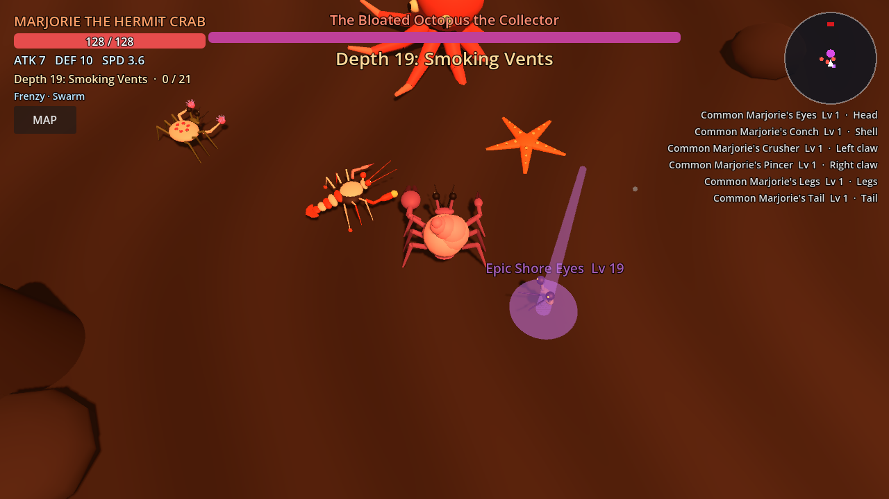
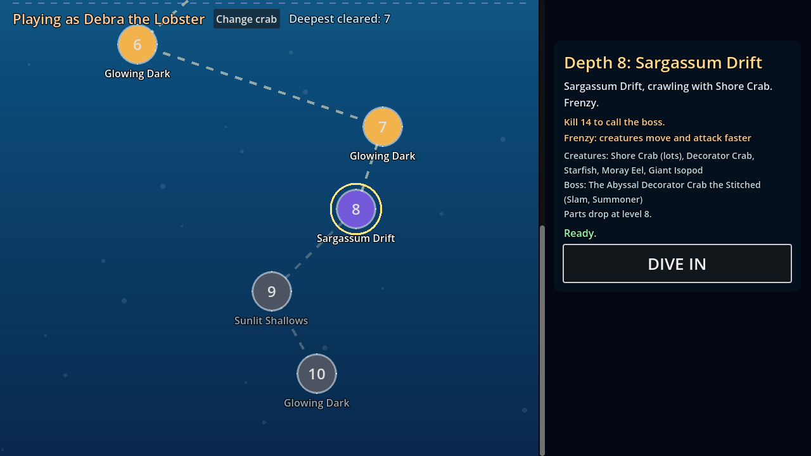
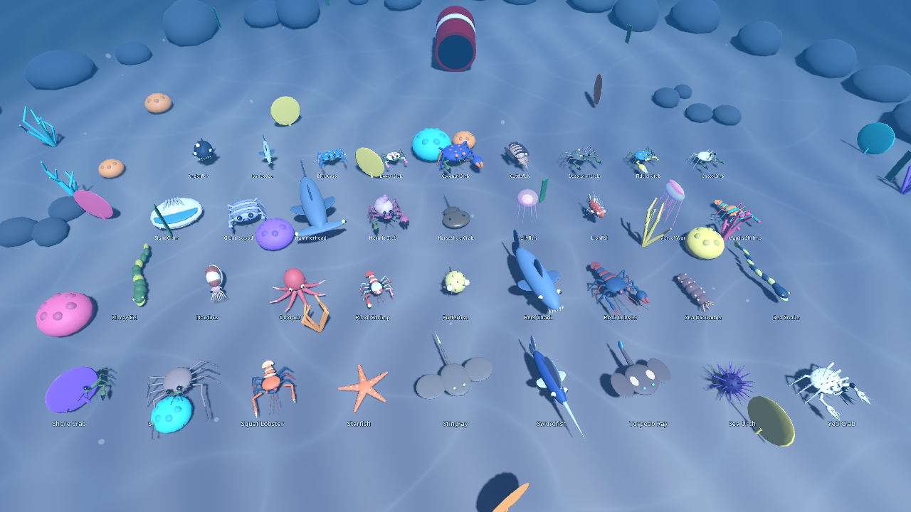

# Debra

A 3D action RPG where you play a little crustacean on the seafloor. Every kill drops a body part, and wearing it changes your stats, your attacks and your look. **You are what you kill.**

Pick a crab, pick a depth, and dive. No plot. The sea goes down forever.

Built with **Godot 4.7.2**. It runs as a **Windows exe** and as a **mobile web app**.





## What's in it
- **5 starter crustaceans:** Debra the Lobster, Saul the Crab, Louise the Shrimp, Marjorie the Hermit Crab and Gary the Spider Crab. Each crab keeps its own mutations.
- **An endless dive.** Five hand-made depths, then generated ones forever. Every depth has a biome, an arena layout, a featured creature, an objective (cull, waves or hunt) and modifiers like Swarm, Riptide or Dark water. The same depth is always the same level.
- **Chimera bosses** that wear parts stolen from other creatures, have traits (summoner, enrage, slam, shell, splitter), and **adapt to how you fight**: snipe them and they rush you, brawl them and they grow thorns. Beat one and a portal opens home.
- **36 kinds of sea creature**: crabs, lobsters, shrimp, isopods, eels, sharks, swordfish, jellyfish, urchins, octopuses, cuttlefish, rays, clams and more.
- **113 body parts in 6 slots.** Claws are your attacks (8 styles). Tails act on their own: they flick you away, stab, zap, lure, spray spines or ram. Deeper parts are stronger.

## Play
- **Web / phone:** open this repo's GitHub Pages URL. On a phone, "Add to Home Screen" gives you fullscreen landscape.
- **Windows:** download `Debra.exe` from the latest Release or Actions run.

| | Keyboard & mouse | Gamepad | Touch |
|---|---|---|---|
| Move | WASD / arrows | Left stick | Left thumb |
| Aim | Mouse | Right stick | Auto-aim |
| Left claw attack | LMB / J | X / LB / LT | L CLAW |
| Right claw attack | RMB / K | B / RB / RT | R CLAW |
| Equip part (left claw) | E / F | A | EQUIP / EQUIP L |
| Equip to right claw | R | Y | EQUIP R |
| Back to map | Esc, or the portal | Start | MAP |
| Dev: random part / spawn / heal / boss | F1 / F2 / F3 / F4 | | |



## Develop
```powershell
powershell -ExecutionPolicy Bypass -File tools/setup-godot.ps1   # one-time: Godot 4.7.2 + export templates into .tools/
powershell -ExecutionPolicy Bypass -File tools/test.ps1          # smoke test
powershell -ExecutionPolicy Bypass -File tools/build.ps1         # exe + web into builds/
node tools/serve-web.mjs                                         # http://localhost:8060 (phones: use the LAN address it prints)
```
To edit in the Godot editor, open `game/project.godot` with `.tools/godot/Godot_v4.7.2-stable_win64.exe`.

Docs: [design](docs/DESIGN.md) · [architecture](docs/ARCHITECTURE.md) · [Claude guide](CLAUDE.md) · [original handoff](projectContext/DEBRA_HANDOFF.md)
